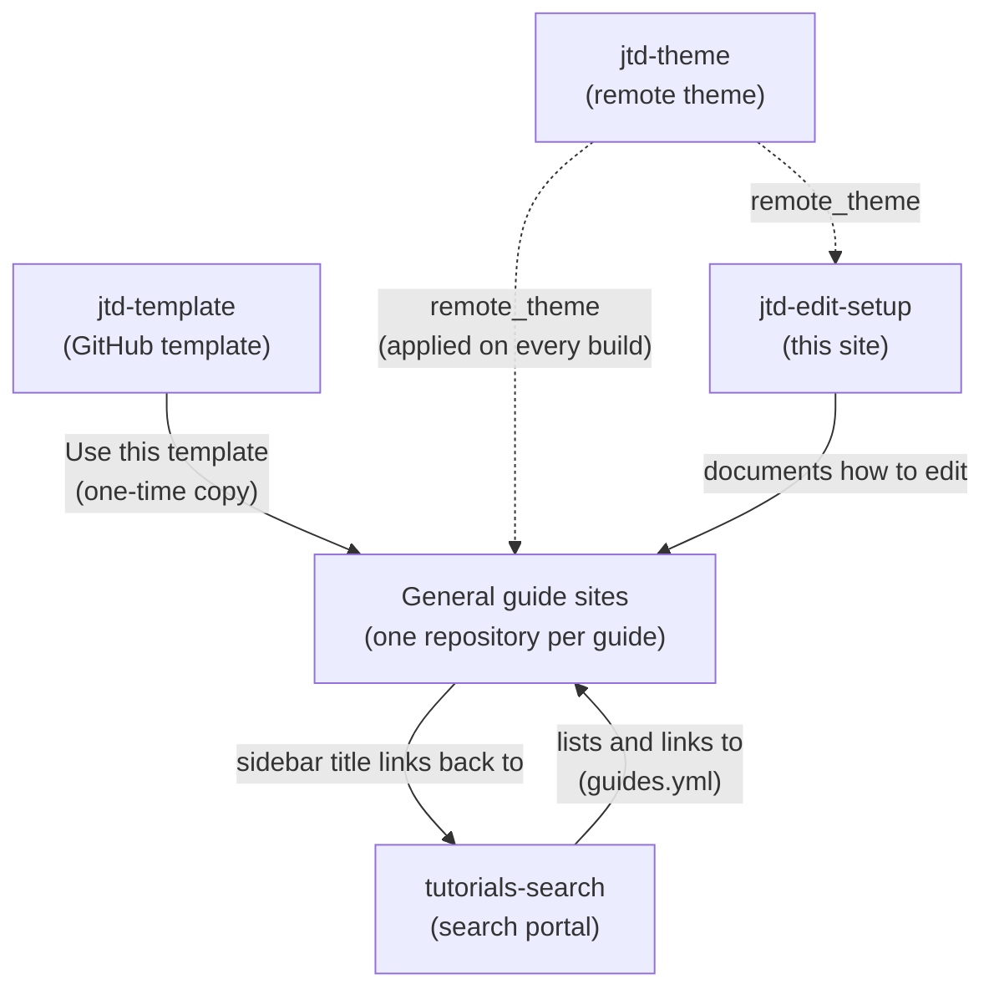

# Introduction

Welcome to the Just-the-docs documentation home page for the Map & Data Library at the University of Toronto Libraries. Here you will find the guide on how to edit our just-the-docs based sites

# Structure of MDL just-the-docs sites

There are two main types of just-the-docs sites hosted by MDL via GitHub Pages:
1. **General guides sites**: These are the main how-to-guides for various topics, such as GIS, data visualization, etc. It is meant to be browsed by patrons, and was hosted on MDL Drupal site previously.
2. **Special sites**: These are just-the-docs sites that serve specific purposes, such as search portals, documentation for editing, etc.

## How the sites are related

- **jtd-theme** controls the layout, styles and components of the guide sites and this site. A change to the theme appears on those sites the next time each one is built.
- **jtd-template** is a GitHub template. A new guide is created from it with the `Use this template` button, which copies its files once. Later changes to the template do **not** reach existing guides. See [Breaking changes to _config.yml]({{ '/breaking-changes/' | relative_url }}) for the changes that existing guides need to apply by hand.
- **General guide sites** are created from the template and use the theme. Each guide has its own repository.
- **tutorials-search** is the entry point for patrons. It lists every guide from its `guides.yml` file, so it must be updated whenever a guide is created, renamed or removed. See [Edit the tutorials-search Records]({{ '/edit-tutorials-search/' | relative_url }}).
- **jtd-edit-setup** (this site) is the documentation for editing all of the above.

## Special sites


<table>
  <thead>
    <tr>
      
        <th>{{ header[0] }}</th>
      
    </tr>
  </thead>
  <tbody>
    
      <tr>
        
          
            <td><a href="{{ cell[1] }}" target="_blank">{{ cell[1] }}</a></td>
          
            <td>{{ cell[1] }}</td>
          
        
      </tr>
    
  </tbody>
</table>